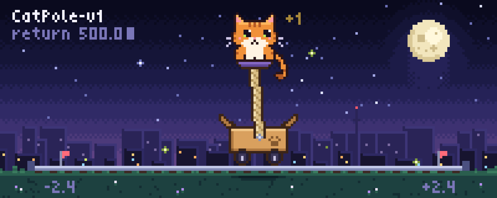
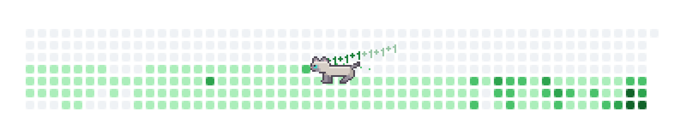

  

<h1 align="center">Hi, I'm Mark</h1>

I do LLM post-training and scaling RL.

  <picture>
    <source media="(prefers-color-scheme: dark)" srcset="assets/catsnake-dark.gif">
    
  </picture>

<!-- The banners are drawn by make_gif.py and make_snake.py (the snake reads my public contribution graph). -->
